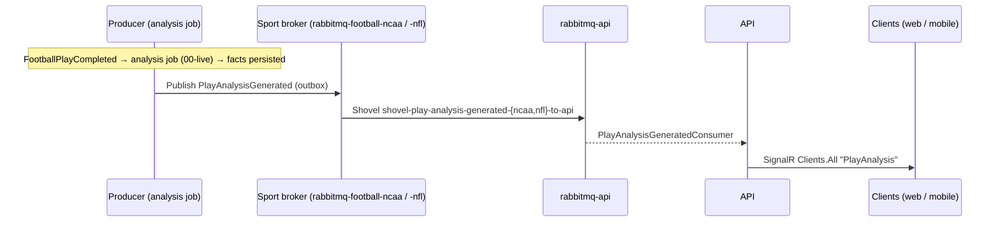

# PlayAnalysisGenerated

Instant-analysis facts for one live play ("T. Cooley's second interception of
the season."). Producer's analysis job publishes it after persisting the play's
fact set (`PlayAnalysis` rows), through the EF outbox in the same save, so the
event goes out only if the rows commit. Published for **live** analysis only;
replay-lab runs never publish. Football only today.

See [docs/features/instant-analysis/instant-analysis.md](../../features/instant-analysis/instant-analysis.md)
(Stage 7: deliver) and task [10](../../features/instant-analysis/10-delivery.md).

## Flow Diagram

## Payload

| Field | Type | Notes |
|---|---|---|
| `ContestId` | Guid | |
| `CompetitionId` | Guid | Producer-internal; kept for trace/debug. |
| `PlayId` | Guid | The play the facts belong to. Clients show the items only while this is the contest's latest play. |
| `Items` | `PlayAnalysisItem[]` | In display order (fact-type priority, lowest first). Never empty: a play with no facts publishes nothing. |
| `Items[].Id` | Guid | The `PlayAnalysis` row id. |
| `Items[].FactType` | string | e.g. `SeasonCount`, `GameCount`, `TeamGameCount`, `GameLongest`, `SeasonLongest`, `SeasonCountAgainst`, `GameCountAgainst`. |
| `Items[].Text` | string | The rendered sentence. |
| `Ref` | Uri? | Always null. |
| `Sport` | enum | `FootballNcaa` or `FootballNfl`. |
| `SeasonYear` | int? | |
| `CorrelationId` | Guid | The triggering `FootballPlayCompleted`'s correlation id. |
| `CausationId` | Guid | `CausationId.Producer.PlayAnalyser`. |
| `MessageId` | Guid | Inherited from `EventBase`. |
| `CreatedUtc` | DateTime | Inherited from `EventBase`. |

## Consumers

| Service | Consumer | Action |
|---|---|---|
| API | `PlayAnalysisGeneratedConsumer` (`Application/Plays/Consumers`) | `Clients.All.SendAsync("PlayAnalysis", message)` on `NotificationHub`. |

## Routing

- Exchange: `SportsData.Core.Eventing.Events.Contests:PlayAnalysisGenerated` (MassTransit fanout).
- Prod: shovels `shovel-play-analysis-generated-ncaa-to-api` and `-nfl-to-api` in sports-data-config
  (`app/base/rabbitmq/shovels/`). Pre-declare the exchange on each football broker before they reconcile
  (MassTransit declares it only on first publish).
- Local: one shared broker, no shovel.

## Notes

- Can trail its `FootballPlayCompleted` by a hop (the analysis job runs after it), so clients key by `PlayId`.
- At-least-once: a redelivered analysis job finds the play's facts already persisted and publishes nothing,
  so a play's event is not duplicated by job retries. A message itself may still be redelivered by the broker;
  clients should treat a second event for the same `PlayId` as a replacement.
